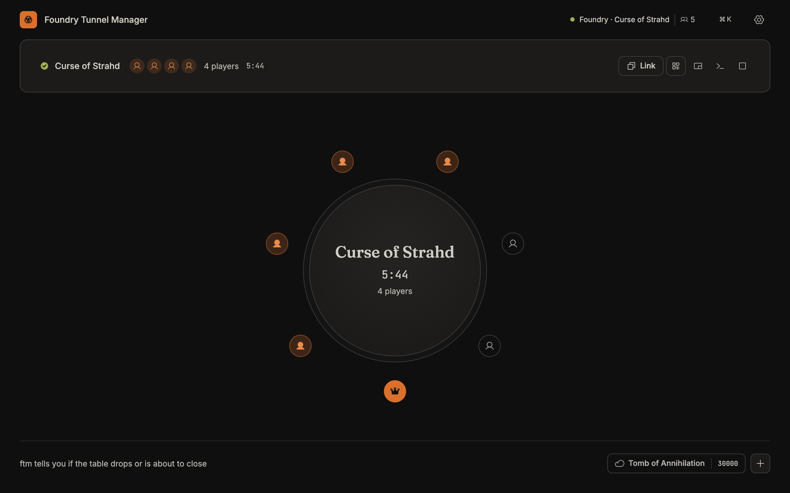
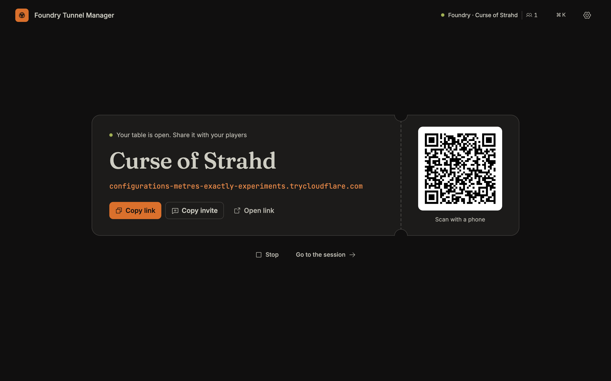
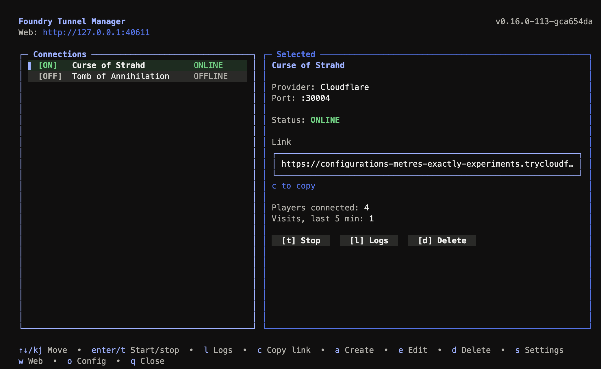

<h1 align="center">ftm</h1>

<p align="center">
  <strong>Foundry Tunnel Manager</strong><br />
  Share your Foundry world with players everywhere.
</p>

<p align="center">
  <a href="https://github.com/sthbryan/ftm/releases/latest"></a>
  <a href="https://github.com/sthbryan/ftm/actions/workflows/ci.yml"></a></p>

<p align="center">
  <a href="#install">Install</a>
  ·
  <a href="#quick-start">Quick start</a>
  ·
  <a href="#three-ways-to-run-it">Interfaces</a>
  ·
  <a href="#providers">Providers</a>
  ·
  <a href="#development">Development</a>
</p>

<p align="center">
  <picture>
    <source media="(prefers-color-scheme: light)" srcset="docs/screenshots/session-light.png" />
    
  </picture>
</p>

Your players need a way into your Foundry world, and your router, your ISP or CGNAT won't open one. Port forwarding is fiddly, and free tunnel tools mean remembering flags and watching a terminal all night.

ftm opens the way in for you. Pick a provider, tell it Foundry's port, send the link. It shows who is at the table, and it tells you when a link drops or is about to close, before your players notice.

## What it does

- **Opens a public link to Foundry** through Cloudflare, Pinggy, Tunnelmole, Bore, localhost.run or Serveo. No port forwarding, no account needed for most of them.
- **Finds Foundry for you.** ftm checks the usual ports, reads the world and system Foundry is running, and fills in the port.
- **Shows the table.** Each player who connects through the link takes a seat, so you see who is in without asking in chat.
- **Warns you early.** A notice when a link drops, and before a time-limited link closes.
- **Installs what it needs.** The tunnel program for the provider you pick is downloaded the first time you use it.
- **Runs where you are.** A terminal UI, a web dashboard and a desktop app, all driving the same connections.

## Screenshots

<table>
  <tr>
    <td width="50%">
      <picture>
        <source media="(prefers-color-scheme: light)" srcset="docs/screenshots/invite-light.png" />
        
      </picture>
    </td>
    <td width="50%">
      
    </td>
  </tr>
  <tr>
    <td align="center"><sub>The link is ready to send, as text, as an invite or as a QR code</sub></td>
    <td align="center"><sub>The same connections in the terminal</sub></td>
  </tr>
</table>

## Install

| | |
|---|---|
| **Homebrew** (macOS, Linux) | `brew install sthbryan/tap/ftm-cli` for the CLI, `brew install --cask sthbryan/tap/ftm` for the macOS app |
| **Install script** (macOS, Linux) | `curl -fsSL https://raw.githubusercontent.com/sthbryan/ftm/main/install.sh \| bash` |
| **Windows** | `ftm-desktop-windows.exe` or `ftm-windows-x64.exe` from the [latest release](https://github.com/sthbryan/ftm/releases/latest) |
| **Linux desktop** | `ftm-desktop-linux-x86_64.AppImage` from the [latest release](https://github.com/sthbryan/ftm/releases/latest) |
| **From source** | `make install`, with Go 1.26+ and Bun |

<details>
<summary><strong>Homebrew details</strong></summary>

The cask signs the app ad hoc and clears quarantine on install, so the first launch works without `xattr`. The formula installs the CLI as `ftm` on every platform.

```bash
brew update && brew upgrade ftm-cli
brew update && brew upgrade --cask ftm
brew uninstall --cask --zap ftm   # also removes settings and caches
```

</details>

<details>
<summary><strong>Install script details</strong></summary>

The script detects your OS and architecture, installs the CLI to `~/.local/bin` (change it with `INSTALL_DIR`) and clears macOS quarantine when needed.

</details>

<details>
<summary><strong>Linux AppImage</strong></summary>

```bash
chmod +x ftm-desktop-linux-x86_64.AppImage
./ftm-desktop-linux-x86_64.AppImage
```

One file, no install step, with its icon and menu entry. It runs on any distribution with glibc 2.35 or newer (Ubuntu 22.04+, Debian 12+, Fedora 36+, current Arch).

WebKitGTK 4.1 ships inside the image, helper processes included. WebKitGTK looks for those helpers at a path compiled into `libwebkit2gtk`, so `scripts/relocate-webkit.py` rewrites that path to a short fixed one and the `AppRun` hook links it back into the AppDir. That is what lets the AppImage run on machines other than the one that built it.

</details>

<details>
<summary><strong>Release files</strong></summary>

| Platform | CLI | Desktop app |
|---|---|---|
| Windows | `ftm-windows-x64.exe` | `ftm-desktop-windows.exe` |
| Linux x64 | `ftm-linux-x64` | `ftm-desktop-linux-x86_64.AppImage` |
| Linux ARM64 | `ftm-linux-arm64` | |
| macOS Intel | `ftm-macos-x64` | `ftm-desktop-macos.app.zip` |
| macOS Apple Silicon | `ftm-macos-arm64` | `ftm-desktop-macos.app.zip` |

```bash
chmod +x ftm-macos-arm64
mv ftm-macos-arm64 ~/.local/bin/ftm
xattr -d com.apple.quarantine ~/.local/bin/ftm   # only if Gatekeeper blocks it
```

</details>

## Quick start

1. Launch your world in Foundry.
2. Run `ftm`, or open the desktop app.
3. Add a connection: pick a provider. ftm finds Foundry's port (usually 30000).
4. Open the table and send the link to your players.

```bash
ftm                  # terminal UI, with the dashboard at http://localhost:40500
ftm serve --open     # dashboard only, opened in your browser
ftm share            # open a connection, copy the link and print an invite
```

## Three ways to run it

**Desktop app.** A native window around the dashboard, with a small pop-out panel that stays on top while you run the game. Use it if you'd rather not keep a terminal open.

**Web dashboard.** Always on while ftm runs, at `http://localhost:40500` (another port if that one is busy). Ten themes in light and dark, a command palette on `⌘K` / `Ctrl+K`, and English, Spanish and Portuguese.

**Terminal UI.** Run `ftm` with no arguments.

| Key | Action |
|---|---|
| `↑` / `↓` | Move |
| `enter` / `t` | Start or stop |
| `c` | Copy the link |
| `l` | Logs |
| `a` / `e` / `d` | Add, edit, delete |
| `w` | Open the dashboard |
| `o` | Open the config file |
| `s` | Settings |
| `?` | All shortcuts |
| `esc` | Back to the list |
| `q` | Back, or quit from the list |

All three share one core. When ftm is already running (the desktop app, `ftm serve` or the TUI), every other surface and command attaches to it, so a change in one shows in the others right away.

## Commands

| Command | Effect |
|---|---|
| `ftm` | Terminal UI and dashboard |
| `ftm up [name…] [--all]` | Open connections and print their links |
| `ftm down [name…]` | Close connections (all open ones when none is named) |
| `ftm share [name] [--port N]` | Open a connection, copy the link, print an invite |
| `ftm ls [--json]` | List connections and their state |
| `ftm add [name] [--provider P] [--port N]` | Save a connection (asks on a terminal) |
| `ftm edit <name>` · `ftm rm <name…>` | Change or remove connections |
| `ftm logs <name> [-f]` | Print or follow a connection's output |
| `ftm providers [ls\|install\|update]` | Tunnel programs: versions, download, update |
| `ftm doctor` | Check providers, ssh key, Foundry's port, the config folder and start at login |
| `ftm serve [--open] [--port N]` | Dashboard only, no terminal UI |
| `ftm config [path\|get\|set\|edit]` | Read and change settings |
| `ftm self-update [--check]` | Update to the latest release |
| `ftm uninstall` · `ftm version` | Remove ftm · print the version |
| `ftm completion <shell>` · `ftm man` | Shell completions · man page |

Run `ftm <command> --help` for the details. The old flags (`-web`, `-server`, `-port`, `-update`, `-check`, `-uninstall`, `-version`) still work.

## Providers

| Provider | Time limit | Needs |
|---|---|---|
| **Cloudflare** | None, new link each time | `cloudflared`, downloaded for you |
| **Pinggy** | 60 minutes on the free plan | `ssh` |
| **Tunnelmole** | None | `tunnelmole`, downloaded for you |
| **Bore** | None | `bore`, downloaded for you |
| **localhost.run** | None | `ssh` |
| **Serveo** | None | `ssh` |

Cloudflare is the default. Quick tunnels ignore your own `~/.cloudflared/config.yml`, so a named tunnel you set up for something else won't catch Foundry's traffic.

A public link reaches anyone who has it. Foundry's own login is what keeps your world private, so give every user a password.

## Development

Go 1.26+ and Bun. The desktop app uses [Wails v3](https://v3.wails.io) (CGO and the platform webview); the `wails` CLI is not needed to build it.

```bash
make dev          # build the web assets, then run ftm
make build-full   # web assets + bin/ftm with the UI embedded
make test         # go test ./...
make desktop      # desktop app → cmd/ftm-desktop/build/bin/ftm-desktop
make help         # every target
```

For the dashboard with hot reload against a running ftm:

```bash
cd web && bun run dev
```

The web UI is Preact with [Sephiro](https://github.com/Zovaris/Sephiro) components, [Phosphor](https://phosphoricons.com) icons and Cuelume sounds. API types are generated from the OpenAPI spec (`bun run gen:api`), and CI fails when they are out of date.

### Trying it without Foundry

`tools/fakefoundry` stands in for Foundry: it serves a page titled like Foundry's, answers `/api/status` the way Foundry 14 does and keeps player WebSockets open.

```bash
go run ./tools/fakefoundry                          # Foundry on :30000 with a world launched
go run ./tools/fakefoundry -port 30004 -setup       # on the setup screen, no world
go run ./tools/fakefoundry players <link> -n 4      # four players join through a table's link
```

In its terminal view, press `l` to paste the table's link and `+` / `-` to add or remove players. They join through the tunnel, so ftm counts them as it would real players.

### Layout

```
cmd/ftm            CLI and terminal UI entry point
cmd/ftm-desktop    Wails desktop app
internal/core      connections and their state
internal/provider  one package per tunnel provider, plus downloads
internal/supervisor  runs tunnel processes and the local proxy that counts players
internal/transport/httpapi  REST + SSE API (huma), serves the embedded dashboard
internal/ui/tui    Bubble Tea terminal UI
internal/i18n      en, es and pt strings
web/               Preact dashboard
```

How the app talks, in every language, is in [docs/voice.md](docs/voice.md).

### Releasing

```bash
make version                  # interactive: patch, minor, major or a custom version
make version ARGS="patch"     # no questions
make version ARGS="0.17.0 --dry-run"
```

`make version` updates the version in `internal/version/version.go`, `web/package.json` and `cmd/ftm-desktop/wails.json`, commits `chore(release): vX.Y.Z`, tags it and pushes. The tag starts the release workflow. Flags: `--dry-run`, `--no-push`, `--allow-dirty`, `--yes`.

### macOS notifications from the TUI

Install `alerter` (`brew install alerter`) for native notices. The desktop app and the dashboard use the platform APIs.

---

<p align="center">
  <sub>MIT License · © 2026 Bryan Villafuerte</sub>
</p>
